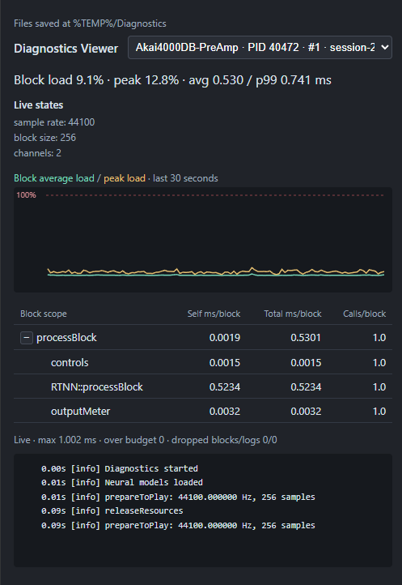
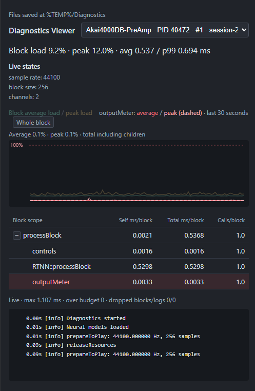

# Diagnostics Viewer

A C++17 profiler for measuring blocks of work, with a separate Python viewer.
Use it to view timings, numeric values and logs from any C++ application.
The library has no external framework dependencies.

## Start the viewer

The viewer needs Python 3.9+ and a browser. No pip packages are required.

```powershell
python Tools/diagnostics_viewer.py
```

Choose a session from the dropdown when several applications are running.
Block scopes start collapsed. Add `--terminal` for a terminal
display, or `--help` to see other options.

Session files are saved in the system temporary directory's `Diagnostics` folder.
Old files are to be deleted manually, when no longer needed.

<p align="center">
  
</p>

## Add to your project

Use CMake 3.22+ and a C++17 compiler. For a local checkout, add this to your
application's `CMakeLists.txt`:

```cmake
add_subdirectory("../diagnostics-viewer" diagnostics-viewer)
target_link_libraries(MyApplication PRIVATE Diagnostics::Diagnostics)
```

This assumes the `diagnostics-viewer` repository folder is beside your application.
Adjust the path if you store it elsewhere.

If Python is available when configuring the project, you can also start the
viewer through CMake:

```powershell
cmake --build build --config RelWithDebInfo --target diagnostics_viewer
```

## Measure a block

Create a session before processing starts. Names in `scopes` and `values` are
assigned IDs in list order, starting at zero.

A **scope** is a named region of code whose execution time you measure. It can cover
an entire function, part of a function, or several function calls.

A **value** is a numeric state you record, displayed by the viewer under the
"Live states" field:

```cpp
#include <diagnostics/Diagnostics.h>
#include <utility>

diagnostics::Config config;
config.application = "MyApplication";
config.scopes = { "block", "foo", "bar" }; // IDs 0, 1, 2
config.values = { "sample_rate" };         // ID  0

diagnostics::Session session(std::move(config));
```

`diagnostics::Block` is a specific C++ type. In this declaration:

```cpp
diagnostics::Block block(session, info);
```

`diagnostics::Block` is the type, and `block` is the variable name.
Constructing that object automatically starts scope `0`. Destroying it
stops scope `0` and submits the measurements. Inner `diagnostics::Scope`
objects record measurements within that block.

Scope `0` therefore represents the lifetime of the `Block` object. It represents
an entire function only if you arrange that lifetime to cover the entire function.
For example:

```cpp
void processFrame(diagnostics::Session& session, diagnostics::BlockInfo info)
{
    diagnostics::Block measurement(session, info);

    // Everything measured until this function returns.
}
```

Here, scope `0` covers the function body from the declaration onward. Its displayed
name comes from `config.scopes[0]`, which could be `"block"` or another label.

Set scope and value names before processing starts, with up to eight of each.
At most **eight scopes** can be active at once, including the whole block.
The implementation stores parent relationships in an eight-bit mask.
Additional configured names and attempts to exceed the scope ID or nesting limits
are ignored. Use one callback producer and one block at a time per session. Scope
lifetimes must be nested: end inner scopes before their outer scopes.

Each ID identifies one measurement entry:

```cpp
void processFrame(diagnostics::Session& session,
                  double budgetMilliseconds, double sampleRate)
{
    diagnostics::BlockInfo info;
    info.budgetMs = budgetMilliseconds;

    diagnostics::Block block(session, info); // scope 0: the whole block
    {
        diagnostics::Scope foo(block, 1);
        {
            diagnostics::Scope bar(block, 2);
            // Stuff I want to measure with bar...
        }
        // Other stuff I want to measure with foo...
    }

    block.setValue(0, sampleRate);
}
```

The local variables `foo` and `bar` are timer objects; functions with those names
do not need to exist. Their IDs select the display labels from `config.scopes`.

Inside a live block, you can measure an entry repeatedly:

```cpp
for (int i = 0; i < 10; ++i)
{
    diagnostics::Scope timer(block, 1);
    // Work to measure.
}
```

This creates and destroys ten timer objects, all using ID `1`. For this block,
that entry records:

- Calls: 10.
- Total time: the sum of those ten measurements.

It still uses just one of the eight scope slots. The viewer averages these measurements
per block over each reporting update, i.e. it does not create ten rows.

Scope `0` measures the whole block automatically, leaving seven IDs for inner regions.
Those IDs belong to the session’s name list. They do not represent depth or position
in the tree. For example, this uses all eight slots:

```text
block (scope 0)
├── foo (scope 1)
│   ├── bar (scope 2)
│   └── mix (scope 3)
├── update (scope 4)
├── cleanup (scope 5)
├── write (scope 6)
└── finish (scope 7)
```

Create and destroy sessions outside realtime callbacks; stop callbacks before
destroying their session. This example uses a simplified JUCE-inspired lifecycle:

```cpp
class MyAudioProcessor
{
public:
    // Called before audio processing starts.
    void prepareToPlay(double rate, int /*expectedBlockSize*/)
    {
        m_sampleRate = rate;

        diagnostics::Config config;
        config.scopes = { "processBlock" };
        config.values = { "block_size" };

        // Create the session and keep it as a member.
        m_session = std::make_unique<diagnostics::Session>(
            std::move(config));
    }

    // Called repeatedly by the host: once per audio buffer.
    void processBlock(int numSamples)
    {
        diagnostics::BlockInfo info;
        info.budgetMs = 1000.0 * numSamples / m_sampleRate;

        diagnostics::Block block(*m_session, info); // Starts scope 0.
        block.setValue(0, numSamples);

        // Your audio processing goes here.

    } // block is destroyed: timing stops and measurements are queued.

    // Called after audio processing has stopped.
    void releaseResources()
    {
        m_session.reset(); // The Session is destroyed HERE.
    }

private:
    double m_sampleRate = 0.0;
    std::unique_ptr<diagnostics::Session> m_session;
};
```

The host or audio engine calls `prepareToPlay()` before processing starts,
`processBlock()` repeatedly on the audio thread, and `releaseResources()` after
processing has stopped. `processBlock()` processes a buffer when called.

To illustrate the call order without an audio device:

```cpp
MyAudioProcessor processor;
processor.prepareToPlay(48000.0, 128);

// A real host makes these calls on the audio thread, once per buffer.
processor.processBlock(128);
processor.processBlock(128);

// After the host has stopped processing and all callbacks have finished:
processor.releaseResources();
```

The `block` object is local to one invocation of the callback. Each invocation
gets a new block; the same session receives all their measurements.

The audio processing you want to measure must happen after the block is constructed
and before it is destroyed.

When a block is destroyed, it puts its measurements into the session’s queue.
The callback does not write the file itself: the session’s background worker collects
those measurements and writes a report roughly every 250 ms. The Python viewer reads
that file, and the browser displays the reports.

## Read the timings

Scope `0` covers the whole block. Other scopes measure work inside it.

Only work instrumented with `diagnostics::Scope` appears as a tree entry.
For example, with measurement code inside the functions:

```cpp
void bar(diagnostics::Block& block)
{
    diagnostics::Scope timing(block, 2);
    // Work performed by bar.
}

void foo(diagnostics::Block& block)
{
    diagnostics::Scope timing(block, 1);
    bar(block);
    // Other work performed by foo.
}
```

Calling `foo(block)` while the block is alive might produce:

```text
block (scope 0): 10 ms total
└── foo (scope 1): 7 ms total
    └── bar (scope 2): 2 ms total
```

| Scope | Total time | Self time |
| --- | --- | --- |
| `block` | 10 ms | 10 - 7 = **3 ms** |
| `foo` | 7 ms | 7 - 2 = **5 ms** |
| `bar` | 2 ms | **2 ms** (no child scopes) |

The 7 ms in `foo` already includes the 2 ms in `bar`. Timings and call counts
are averaged per block.

If a scope ID is used under multiple parents, its combined timings appear at
the top level.

**Load** shows how much of a block's time budget was used. A block taking 2 ms
with a 4 ms budget has 50% load. Above 100% means it took longer than allowed.

For audio, set `budgetMs` to `1000.0 * actualBlockSize / sampleRate` (floating-point
division), where `actualBlockSize` is the number of sample frames per channel in
that callback.

The budget belongs to the `Block`, rather than to its individual `Scope` objects.
It describes how much time you have to finish all the work measured by that block.

Suppose one callback processes 128 sample frames at 48,000 Hz. Its budget is:

```text
1000 × 128 / 48000 ≈ 2.667 ms
```

You can measure each sample inside that block:

```cpp
diagnostics::BlockInfo info;
info.budgetMs = 1000.0 * numSamples / sampleRate;

diagnostics::Block block(session, info);

for (int i = 0; i < numSamples; ++i)
{
    diagnostics::Scope sampleTimer(block, 1);
    // Process sample frame i.
}
```

All 128 measurements use scope ID `1`, so their durations accumulate in one scope entry.
If processing each frame takes 5 microseconds, that entry records:

```text
Calls:       128
Total time:  128 × 5 microseconds = 0.640 ms
Scope load:  0.640 / 2.667 × 100 ≈ 24%
```

The viewer displays that accumulated time per block, rather than the average time
per individual sample. The whole block’s duration also includes loop overhead
and other work.

Setting this block’s budget to one sample’s duration — 20.833 microseconds —
would compare 128 frames of work against the time available for just one frame.
That would make the load misleading.

The one-frame budget fits this different arrangement:

```cpp
for (int i = 0; i < numSamples; ++i)
{
    diagnostics::BlockInfo info;
    info.budgetMs = 1000.0 / sampleRate;

    diagnostics::Block sampleBlock(session, info);
    // Process sample frame i.

} // One measurement record submitted for each frame.
```

Here, each `Block` measures just one frame. However, it also submits its own record:
at 48,000 Hz, that produces 48,000 records per second, compared with 375 records
per second for 128-frame buffers.

Average load compares total block time with total budget time, so changing block
sizes is supported.

The graph shows **average** and **peak** (highest) load; the red line marks 100%.
**P99** describes how slow the slower blocks are, without focusing only on the
single worst block.

The status bar keeps the session's highest recorded block time and total count of
recorded over-budget blocks.

Inner scopes can also be individually highlighted on the graph:

<p align="center">
  
</p>

Each `Block` submits one record containing its scope measurements and numeric values.
Repeated `Scope` measurements inside that block accumulate in the same record.

The queue holds exactly 1,023 pending measurement records — one of its 1,024 slots
stays unused to distinguish a full queue from an empty one.
If that queue fills, the profiler discards a measurement
and increments “dropped blocks.” Logs can be dropped when their queue is full or its
mutex is busy.

Note that these are dropped diagnostic records, and the real processing continues.
The viewer's statistics cover only the records received, so dropped records make
results incomplete.

For useful comparisons, use the same machine and workload; for audio, keep sample
rate and buffer size the same. Machine speed and workload affect execution time;
sample rate and buffer size affect the available budget.

For example, changing from 128 to 512 frames also increases the budget, so lower load
alone would not demonstrate faster code.

## Logs

Log messages to a session with:

```cpp
session.log("Started");
session.log("Something went wrong", "warning");
```

Keep logging and printing outside realtime callbacks, as audio callbacks need
predictable execution time. `session.log()` also uses a mutex, although it tries the lock
and drops the message if busy.

To report a registered numeric value from a callback, use:

```cpp
block.setValue(0, sampleRate);
```

This stores a number in the block’s fixed storage, without allocation, locking, or
I/O. The worker publishes the latest recorded block's values in each report.

To also capture `std::cout` and `std::cerr`, set this before creating the session:

```cpp
diagnostics::Config config;
config.captureStandardStreams = true;
diagnostics::Session session(std::move(config));

std::cout << "Started\n";
```

Output still goes to its original destination — typically the terminal — and also becomes
a diagnostic log. Consequently, if sessions `A` and `B` both enable capture, both receive
that captured message. An explicit `sessionA.log("Started")` goes only to `A`.

Capture intercepts `std::cout` and `std::cerr`. Calls such as `printf()` and direct
debugger output bypass that interception.

## Run the tests

```powershell
cmake -S . -B build-diagnostics-tests -DDIAGNOSTICS_BUILD_TESTS=ON
cmake --build build-diagnostics-tests --config Debug
ctest --test-dir build-diagnostics-tests -C Debug --output-on-failure
```
